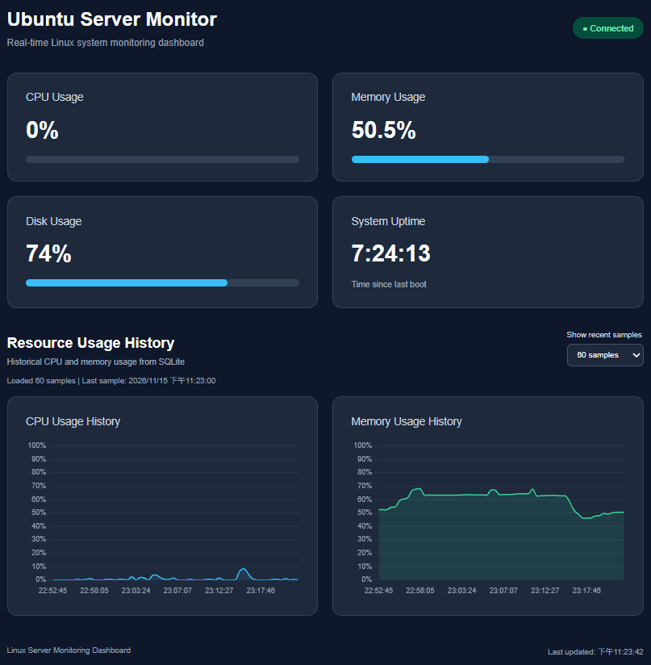

# Linux Server Monitoring Dashboard

> **Project version / 專案版本：** v0.5 — Docker Containerization (Completed)
> **Language / 語言：** English + 繁體中文

A lightweight, browser-based Linux system monitoring application built with **Python, Flask, psutil, HTML, CSS, and JavaScript**, deployed using **Gunicorn and Nginx**. Version v0.3 integrates **systemd service management** for automatic startup, process supervision, and failure recovery.

這是一個以 **Ubuntu Linux 伺服器監控**為主題的實作專案。使用 Python 蒐集系統資訊、Flask 提供 REST API、JavaScript 更新網頁，並逐步加入 Gunicorn、Nginx 與 systemd，學習如何部署及維護 Linux Web Service。

Developed and tested on **Ubuntu 24.04 LTS** running in VMware Workstation, using VS Code Remote SSH for development.

## Project Overview / 專案介紹

This project provides a web dashboard for monitoring resource usage on an Ubuntu Linux server. It is developed incrementally to practice backend programming, HTTP networking, Linux administration, and deployment troubleshooting.

**專案目的：** 不只讓網頁顯示 CPU、記憶體和硬碟數據，也希望理解「瀏覽器如何向伺服器發送請求」、「Python 服務如何部署」，以及「Linux 如何讓服務穩定運作」。

### Learning Objectives / 學習目標

- Linux command-line operations and system administration（Linux 指令與系統管理）
- Python programming and resource monitoring（Python 程式與系統資源監控）
- Flask backend and REST API design（Flask 後端與 API 設計）
- HTML, CSS, JavaScript, and asynchronous HTTP requests（前端與非同步請求）
- SSH remote development and port forwarding（SSH 遠端開發、Port Forwarding）
- Git version control and GitHub workflows（版本管理與遠端儲存庫）
- WSGI deployment with Gunicorn（使用 Gunicorn 執行 Flask）
- Nginx reverse proxy configuration（反向代理設定）
- Linux process and service management with systemd（程序與服務管理）
- Logging and troubleshooting with journalctl（日誌查詢與故障排除）

## Features / 專案功能

### System Monitoring / 系統監控

- CPU utilization monitoring（CPU 使用率）
- Memory usage monitoring（記憶體使用率）
- Disk usage monitoring（硬碟使用率）
- System uptime tracking（系統持續運作時間）
- REST API returning system metrics as JSON（JSON 格式的監控 API）

### Web Dashboard / 網頁儀表板

- Responsive dashboard（響應式網頁，可適應不同螢幕）
- Automatic refresh every five seconds（約每五秒自動更新）
- CPU, memory, and disk utilization indicators（數值與進度條）
- Connection status and fetch error handling（連線狀態與錯誤提示）
- Last updated timestamp（最後更新時間）

### Linux Deployment / Linux 部署

- Gunicorn WSGI application server
- Nginx reverse proxy for local-network HTTP access
- Gunicorn bound to `127.0.0.1:5000`（後端僅監聽 Ubuntu 本機 Loopback）
- systemd unit file for Gunicorn（v0.3 已建立服務設定檔）
- systemctl and journalctl operations documented（已記錄管理與查詢日誌的方法）

> **Status / 進度提醒：** systemd 的開機自啟、SSH 中斷後存活與失敗自動恢復仍須通過實機驗證；文件中提供操作方式，不代表所有測試已完成。

## Dashboard Preview / 畫面預覽



The dashboard displays metrics collected from the Ubuntu virtual machine.  
畫面數據來自 Ubuntu 虛擬機器，而非 Windows 主機；截圖僅是當下狀態，並非即時圖表。

## Technology Stack / 使用技術

| Component / 項目 | Technology / 技術 | Purpose / 用途 |
|---|---|---|
| Operating System / 作業系統 | Ubuntu 24.04 LTS | Linux 執行環境 |
| Virtualization / 虛擬化 | VMware Workstation | 在 Windows 中執行 Ubuntu VM |
| Language / 程式語言 | Python | 後端及監控邏輯 |
| Backend / 後端 | Flask | 網頁路由與 REST API |
| Monitoring / 系統資訊 | psutil | 讀取 CPU、RAM、Disk、Uptime |
| Frontend / 前端 | HTML, CSS, JavaScript | 儀表板畫面與資料更新 |
| Application Server / 應用伺服器 | Gunicorn | 執行 Flask WSGI Application |
| Reverse Proxy / 反向代理 | Nginx | 接收 Port 80 請求並轉給後端 |
| Service Management / 服務管理 | systemd | 管理 Gunicorn 啟動與重啟 |
| Logs / 日誌查詢 | journalctl | 查詢 systemd Journal |
| Remote Development / 遠端開發 | SSH, VS Code Remote SSH | 在 Windows 上編輯 Ubuntu 專案 |
| Version Control / 版本控制 | Git, GitHub | Commit 與程式碼託管 |

## System Architecture / 系統架構

```text
Windows Browser
      |
      | HTTP Request (Port 80)
      v
Ubuntu Linux Server
      |
      v
Nginx Reverse Proxy
      |
      | Proxy to http://127.0.0.1:5000
      v
Gunicorn WSGI Server  <--- managed by systemd
      |
      v
Flask Application (app.py)
      |
      +-- GET /             -> HTML Dashboard
      +-- GET /static/...   -> CSS / JavaScript
      +-- GET /api/system   -> monitor.py -> psutil -> Linux Metrics

journalctl -> reads logs recorded in the systemd journal
```

**請求流程說明：** Windows 瀏覽器先連到 Ubuntu 的 **Nginx（Port 80）**，Nginx 將請求轉發給 **Gunicorn（Port 5000）**。Gunicorn 執行 Flask；Flask 收到 `/api/system` 請求時，呼叫 `monitor.py`，由 psutil 蒐集資訊並回傳 JSON。前端 JavaScript 再將數字更新到畫面。

**管理流程說明：** systemd 不負責處理 HTTP 請求，而是負責**啟動與監督 Gunicorn 程序**；`journalctl` 則用來查閱服務輸出的日誌。

### Component Responsibilities / 元件職責

| Component | Responsibility / 主要職責 |
|---|---|
| **Nginx** | 接收 HTTP 請求，代理至 Gunicorn（Reverse Proxy） |
| **Gunicorn** | 以 WSGI Worker Process 執行 Flask |
| **Flask** | 處理 `/`、`/api/system` 和靜態檔案路由 |
| **psutil** | 取得 Linux 系統資源資訊 |
| **JavaScript** | 定期呼叫 API，更新 Dashboard DOM |
| **systemd** | 啟動、停止及在符合條件時重啟 Gunicorn |
| **journalctl** | 讀取 systemd Journal 中的服務日誌 |

## Getting Started / 開始使用

### 1. Clone the Repository / 下載專案

```bash
git clone https://github.com/xilin0811/linux-server-monitor.git
cd linux-server-monitor
```

`git clone` 會下載 Repository 與 Git 版本資訊；`cd` 是切換工作目錄。

### 2. Create a Python Virtual Environment / 建立虛擬環境

```bash
python3 -m venv .venv
source .venv/bin/activate
```

`.venv` 用來隔離 Python 套件，避免不同專案的依賴版本互相影響。

### 3. Install Dependencies / 安裝依賴

```bash
python -m pip install -r requirements.txt
```

`-r` 表示從清單檔案讀取套件名稱與版本（包含 Flask、psutil、Gunicorn）。

### 4. Development Mode / 開發模式

```bash
python app.py
```

- Dashboard: `http://127.0.0.1:5000/`
- REST API: `http://127.0.0.1:5000/api/system`

This starts Flask's **development server**, bound to the Ubuntu loopback interface. Use SSH port forwarding if accessing it remotely during development.

這種方式適合開發與除錯；`127.0.0.1` 指的是**執行該程式的 Ubuntu 本機**，不是 Windows。正式部署時改由 Gunicorn 執行。

### 5. Gunicorn Mode / 手動測試應用伺服器

Stop the Flask development server before starting Gunicorn to avoid a Port 5000 conflict.

```bash
gunicorn --workers 2 --bind 127.0.0.1:5000 app:app
```

- `--workers 2`：啟動兩個 Worker Process。
- `--bind 127.0.0.1:5000`：指定監聽位址與 Port。
- `app:app`：從 `app.py` 模組載入名為 `app` 的 Flask 物件。

Test the backend API:

```bash
curl -i http://127.0.0.1:5000/api/system
```

`curl -i` 會顯示 HTTP 回應標頭和內容；成功時通常有 `HTTP/1.1 200 OK` 及 JSON。手動測試完可在原終端機按 `Ctrl + C` 停止。

### 6. Nginx Reverse Proxy / 反向代理

Nginx listens on Port 80 and forwards requests to Gunicorn at `127.0.0.1:5000`.

- Example configuration: [`deployment/nginx.conf`](deployment/nginx.conf)
- Full deployment instructions: [Linux Deployment Guide / 部署教學](docs/deployment.md)
- Trusted LAN access: `http://<UBUNTU_IP>/`

將 `<UBUNTU_IP>` 換成 Ubuntu 實際 IP。這使 Windows 可直接透過 Ubuntu IP 存取網頁，而不用依賴 VS Code Port Forwarding。

### 7. systemd Service / Linux 服務管理（v0.3）

The repository contains a sample service unit: [`deployment/linux-server-monitor.service`](deployment/linux-server-monitor.service).

**Important / 注意：** The file uses environment-specific values such as `User=xilin` and `/home/xilin/projects/linux-server-monitor`. Adjust them for another machine. Stop any manually running Gunicorn before starting the service.

```bash
sudo cp deployment/linux-server-monitor.service /etc/systemd/system/linux-server-monitor.service
sudo systemd-analyze verify /etc/systemd/system/linux-server-monitor.service
sudo systemctl daemon-reload
sudo systemctl enable --now linux-server-monitor
systemctl status linux-server-monitor --no-pager
systemctl is-enabled linux-server-monitor
```

- `cp`：將專案中的 Unit File 複製到 systemd 設定目錄。
- `verify`：檢查 Unit File 可能的設定錯誤，但不保證服務一定可啟動。
- `daemon-reload`：讓 systemd 重新讀取 Unit 設定。
- `enable --now`：**設定開機啟動 + 立即啟動**。
- `status`：確認目前是否 `active (running)`。
- `is-enabled`：確認是否設定為 `enabled`；這與「目前正在運作」不同。

More details and safe verification steps: [Deployment Guide](docs/deployment.md).

## REST API / API 說明

### `GET /api/system`

Returns resource information as JSON. / 透過 HTTP GET 取得 Linux 資源使用狀態。

```json
{
  "cpu_percent": 12.5,
  "memory_percent": 65.7,
  "memory_total_gb": 7.74,
  "memory_available_gb": 2.65,
  "disk_percent": 64.5,
  "uptime": "5:55:17"
}
```

> **Example only / 範例數據：** These are illustrative values, not live measurements. The browser requests updated data approximately every five seconds.

## Project Structure / 專案結構

```text
linux-server-monitor/
├── README.md
├── .gitignore
├── requirements.txt
├── app.py
├── monitor.py
├── templates/
│   └── index.html
├── static/
│   ├── style.css
│   └── dashboard.js
├── deployment/
│   ├── nginx.conf
│   └── linux-server-monitor.service
├── docs/
│   └── deployment.md
└── screenshots/
    └── dashboard.png
```

| File / 檔案 | Description / 功能 |
|---|---|
| `app.py` | Flask 入口、網頁路由和 REST API |
| `monitor.py` | 使用 psutil 蒐集 Linux 系統數據 |
| `requirements.txt` | Python 套件依賴清單 |
| `templates/index.html` | Dashboard HTML 結構 |
| `static/style.css` | 頁面樣式與響應式排版 |
| `static/dashboard.js` | 發送 Fetch API 請求、更新畫面 |
| `deployment/nginx.conf` | Nginx Reverse Proxy 範例設定 |
| `deployment/linux-server-monitor.service` | systemd 啟動與管理 Gunicorn 的 Unit File |
| `docs/deployment.md` | 完整 Linux 部署、驗證與故障排除教學 |

## Troubleshooting / 常見問題

| Symptom / 現象 | First check / 優先檢查 |
|---|---|
| Gunicorn service fails / 服務啟動失敗 | `systemctl status linux-server-monitor --no-pager` |
| Error logs / 查看服務日誌 | `sudo journalctl -u linux-server-monitor -n 50 --no-pager` |
| Port 5000 in use / Port 被占用 | `sudo ss -lntp \| grep ':5000 '` |
| Nginx returns 502 / 反向代理失敗 | 測試 `curl -i http://127.0.0.1:5000/api/system` |
| Windows cannot access / Windows 無法存取 | `hostname -I`、`systemctl status nginx --no-pager`、VMware 網路設定 |

**排除順序建議：** 先確認 Gunicorn，再確認 Nginx，最後確認 Windows 與 VMware 的網路連線。避免一開始就隨意重裝或重開機。

## Development Progress / 開發進度

### v0.1 — Initial Monitoring Dashboard（已完成）

- Implemented Linux resource monitoring using Python and psutil
- Developed Flask REST API and responsive dashboard
- Implemented automatic polling and connection status
- Tested access through SSH port forwarding
- Initialized Git and published the initial Repository

**中文摘要：** 完成後端 API、前端 Dashboard，以及第一版 GitHub 作品。

### v0.2 — Gunicorn & Nginx Reverse Proxy（已完成）

- Deployed Flask using Gunicorn
- Configured Nginx reverse proxy
- Enabled direct HTTP access through the Ubuntu VM's LAN IP
- Added configuration and deployment documentation

**中文摘要：** 從 Flask 開發伺服器升級到 Gunicorn + Nginx，Windows 不必靠 SSH Port Forwarding 即可存取網站。

### v0.3 — systemd Service Management（已完成 / Completed）

- Added a systemd Unit File for Gunicorn（建立 `linux-server-monitor.service`）
- Configured non-root execution, working directory, and virtual environment path（以一般使用者與正確的 Python 環境執行）
- Enabled startup on boot with systemd（設定 Ubuntu 開機自動啟動）
- Configured `Restart=on-failure` and `RestartSec=5`（設定異常自動重啟策略）
- Practiced service operations using `systemctl` and log inspection with `journalctl`（學習服務與日誌管理）
- Verified continued access after SSH disconnect and Ubuntu reboot（確認 SSH 中斷及重開機後仍可存取）
- Verified recovery from a simulated service failure（完成異常恢復驗證）

**Validation Record / 完成驗收紀錄**

| Verification / 驗證項目 | Result / 結果 |
|---|---|
| systemd service is `active (running)` / 服務正常執行 | Passed / 通過 |
| Boot startup is `enabled` / 開機自啟已設定 | Passed / 通過 |
| Dashboard accessible from Windows / Windows 可連線 | Passed / 通過 |
| Dashboard accessible after SSH disconnect / SSH 中斷後持續運作 | Passed / 通過 |
| Dashboard restored after Ubuntu reboot / Ubuntu 重開機後自動恢復 | Passed / 通過 |
| Service logs inspected with `journalctl` / 已檢視服務日誌 | Passed / 通過 |
| Restart-on-failure tested / 已驗證異常自動恢復 | Passed / 通過 |

These results record the tests completed in the author's Ubuntu VMware learning environment. / 以上為專案作者於 Ubuntu VMware 學習環境完成的驗證紀錄。

### v0.4 — Monitoring & Reliability（已完成 / Completed）

- Implemented SQLite-based historical metrics storage.
- Automated metrics collection using systemd Timer.
- Added `/api/history` for historical monitoring data.
- Added CPU and Memory usage history charts using Chart.js.
- Implemented `/api/health` to check Flask and SQLite availability.
- Added structured Python logging for metrics collection.
- Implemented a 7-day data retention policy.
- Added automated database and API tests using pytest.

**中文摘要：**

完成歷史監控資料的收集、儲存、查詢與視覺化，
並加入健康檢查、日誌紀錄、歷史資料清理及自動化測試，
提升監控系統的可維護性與可靠性。


### v0.5 — Docker Containerization（已完成 / Completed）

- Created a Dockerfile based on Python 3.12 Slim.
- Added `.dockerignore` to exclude runtime data and development files.
- Configured a non-root application user.
- Built and tested Docker Images and Containers.
- Practiced Docker Bridge Networking and Port Publishing.
- Verified SQLite persistence with Docker Named Volumes.
- Added Docker Compose for application deployment.
- Implemented a read-only Bind Mount for host monitoring data.
- Integrated Ubuntu host metrics with the containerized Dashboard.
- Added Host Snapshot freshness checks and automated tests.

**中文摘要：**

完成 Flask Monitoring Dashboard 的 Docker 容器化，
實作 Image Build、Container、Network、Volume 與 Docker Compose。

最終部署採混合式架構：Ubuntu systemd Timer 負責
收集主機監控資料，Docker Container 負責 Flask API
與 Dashboard，並透過唯讀 Bind Mount 存取 SQLite
及最新監控資料。

### Run with Docker Compose / Docker Compose 部署

Prerequisite: Docker Engine and Docker Compose installed on Ubuntu.

The Ubuntu host collector must already be configured and running.

```bash
sudo systemctl status metrics-collector.timer --no-pager
python collect_once.py
sudo docker compose up -d --build
sudo docker compose ps
```

API endpoints:

- Dashboard: `http://127.0.0.1:5003/`
- System API: `http://127.0.0.1:5003/api/system`
- History API: `http://127.0.0.1:5003/api/history`
- Health API: `http://127.0.0.1:5003/api/health`

The Docker test port is bound to Ubuntu's loopback interface.
Use SSH Port Forwarding to access it from Windows.

### Monitoring Scope / 監控範圍

- Ubuntu Host Collector: gathers actual Ubuntu VM metrics.
- Docker Dashboard: reads the host-collected metrics.
- Collection interval: approximately 30 seconds.
- SQLite retention: 7 days.
- Docker data access: read-only Bind Mount.
- Docker deployment: web application containerized;
  the host metrics collector remains managed by systemd.

### Verification / 驗收

- Docker build and Compose deployment passed.
- Container networking and port publishing verified.
- Named Volume persistence verified in the lab.
- Read-only host data access verified.
- Host Snapshot freshness checks verified.
- Flask API and pytest tests passed.

### v0.6 — GitHub Actions CI/CD（已完成 / Completed）

- Added automated Python tests using GitHub Actions.
- Added Docker image build and container smoke tests.
- Implemented Pull Request-based development workflow.
- Configured branch protection with required CI checks.
- Added version-tag-based Docker image publishing to GHCR.
- Integrated GitHub Actions authentication with GITHUB_TOKEN.

**中文摘要：**

導入 GitHub Actions 自動化流程，在 Push 或 Pull Request
時執行 Python pytest、Docker Build 及 Flask API Smoke Test。

透過 Branch Ruleset 保護 main 分支，要求 CI 檢查成功後
才能合併程式碼。

使用 Git Version Tag 觸發 Docker Image 發布，
將已驗證的 Image 上傳至 GitHub Container Registry。

### CI/CD Workflow

1. Push code to a feature branch.
2. Create a Pull Request targeting main.
3. Run Python and Docker CI checks.
4. Merge after required checks pass.
5. Create and push a release tag.
6. Publish the verified Docker image to GHCR.

### Docker Image

After publishing v0.6.0, the image can be downloaded with:

```bash
docker pull ghcr.io/xilin0811/linux-server-monitor:v0.6.0
```

The published image supports standalone container mode.

The Ubuntu host monitoring deployment requires a separately
configured host collector and read-only bind-mounted data.

### Current Limitations

- GitHub Actions does not deploy directly to the local VMware VM.
- The project has no public production deployment.
- Authentication and HTTPS are not yet configured.
- The current CI smoke test does not validate all host-specific metrics.

## Future Work / 後續規劃


### v1.0 — Production-Oriented Improvements
- Improve security with authentication and HTTPS.
- Add monitoring alerts and configurable thresholds.
- Improve documentation, tests, and deployment portability.