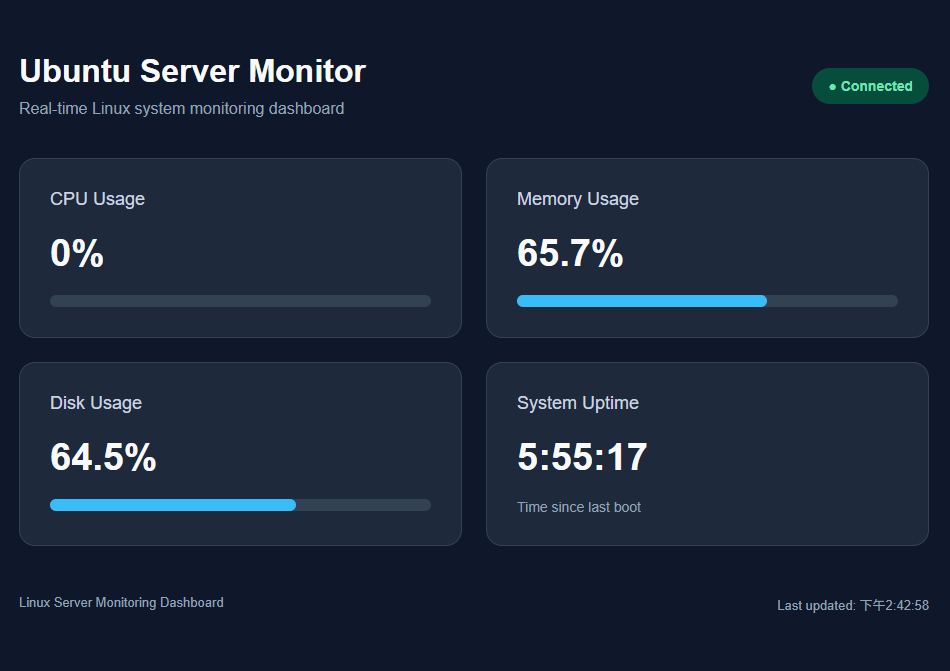

# Linux Server Monitoring Dashboard

A lightweight Linux system monitoring web application built with **Python, Flask, psutil, HTML, CSS, and JavaScript**, deployed using **Gunicorn and Nginx**.

Developed and tested on **Ubuntu 24.04 LTS** running in VMware Workstation, with remote development through VS Code and SSH.

## Project Overview

This project provides a browser-based dashboard for monitoring the resource usage of an Ubuntu Linux server.

The project was developed incrementally to gain hands-on experience in:

- Linux system administration
- Python backend development
- REST API design and HTTP communication
- Frontend development and asynchronous data fetching
- SSH remote development and port forwarding
- WSGI application deployment with Gunicorn
- Nginx reverse proxy configuration
- Git version control and GitHub project management

## Features

- CPU utilization monitoring
- Memory usage monitoring
- Disk usage monitoring
- System uptime tracking
- REST API providing system metrics in JSON format
- Automatic data refresh every 5 seconds
- Connection status and error handling
- Responsive web dashboard
- Gunicorn WSGI application server
- Nginx reverse proxy for local-network access

## Dashboard Preview



The dashboard displays system information collected directly from the Ubuntu virtual machine.

## Technology Stack

| Component | Technology |
|---|---|
| Operating System | Ubuntu 24.04 LTS |
| Virtualization | VMware Workstation |
| Programming Language | Python |
| Backend Framework | Flask |
| System Monitoring | psutil |
| Frontend | HTML, CSS, JavaScript |
| Application Server | Gunicorn |
| Reverse Proxy | Nginx |
| Remote Development | SSH, VS Code Remote SSH |
| Version Control | Git, GitHub |

## System Architecture

The application uses Nginx as the HTTP entry point and Gunicorn as the WSGI application server.

```text
Windows Browser
      |
      | HTTP Request (Port 80)
      v
Ubuntu Linux Server
      |
      v
Nginx Reverse Proxy
      |
      | HTTP (127.0.0.1:5000)
      v
Gunicorn WSGI Server
      |
      v
Flask Application
      |
      +-- /              -> Dashboard HTML
      |
      +-- /static/...    -> CSS / JavaScript
      |
      +-- /api/system    -> JSON System Metrics
                                  |
                                  v
                             monitor.py
                                  |
                                  v
                           psutil / Linux OS
```

### Component Responsibilities

- **Nginx:** Accepts HTTP requests from the Windows client and forwards them to Gunicorn.
- **Gunicorn:** Runs the Flask application using WSGI worker processes.
- **Flask:** Handles web routes and provides the system monitoring API.
- **psutil:** Collects CPU, memory, disk, and system uptime information.
- **JavaScript:** Fetches API data and dynamically updates the dashboard.

## Getting Started

### 1. Clone the Repository

```bash
git clone https://github.com/xilin0811/linux-server-monitor.git
cd linux-server-monitor
```

### 2. Create a Virtual Environment

```bash
python3 -m venv .venv
source .venv/bin/activate
```

### 3. Install Dependencies

```bash
python -m pip install -r requirements.txt
```

### 4. Run in Development Mode

Start the Flask development server:

```bash
python app.py
```

Open the dashboard on the machine running Flask:

`http://127.0.0.1:5000/`

Access the REST API:

`http://127.0.0.1:5000/api/system`

The development server listens on the Ubuntu loopback interface by default.

For remote development, an SSH tunnel can forward the application port to the local computer.

### 5. Run with Gunicorn

Stop the Flask development server before starting Gunicorn.

```bash
gunicorn --workers 2 --bind 127.0.0.1:5000 app:app
```

Gunicorn serves the Flask application on Ubuntu's loopback interface.

Test the API:

```bash
curl -i http://127.0.0.1:5000/api/system
```

### 6. Deploy with Nginx

Nginx receives HTTP requests on Port 80 and forwards them to Gunicorn on `127.0.0.1:5000`.

Example access URL from a Windows client on the trusted virtual-machine network:

`http://<UBUNTU_IP>/`

Replace `<UBUNTU_IP>` with the actual IP address of your Ubuntu server.

For Nginx configuration, setup instructions, and verification commands, see the [Linux Deployment Guide](docs/deployment.md).

## REST API

### GET /api/system

Returns system resource information in JSON format.

Example response:

```json
{
  "cpu_percent": 12.5,
  "memory_percent": 65.7,
  "memory_total_gb": 7.74,
  "memory_available_gb": 2.65,
  "disk_percent": 64.5,
  "uptime": "5:55:17"
}
```

The values shown above are examples. Actual responses depend on the monitored Ubuntu system.

The dashboard retrieves these metrics approximately every five seconds using the JavaScript Fetch API.

## Project Structure

```text
linux-server-monitor/
├── README.md
├── .gitignore
├── requirements.txt
├── app.py
├── monitor.py
│
├── templates/
│   └── index.html
│
├── static/
│   ├── style.css
│   └── dashboard.js
│
├── deployment/
│   └── nginx.conf
│
├── docs/
│   └── deployment.md
│
└── screenshots/
    └── dashboard.png
```

### Main Files

| File | Description |
|---|---|
| `app.py` | Flask application, HTML routes, and REST API |
| `monitor.py` | Linux system metrics collection using psutil |
| `requirements.txt` | Python package dependencies |
| `templates/index.html` | Dashboard page structure |
| `static/style.css` | Responsive dashboard styling |
| `static/dashboard.js` | Periodic API requests and dynamic page updates |
| `deployment/nginx.conf` | Example Nginx reverse proxy configuration |
| `docs/deployment.md` | Gunicorn and Nginx deployment instructions |

## Development Progress

### v0.1 — Initial Monitoring Dashboard

- Implemented Linux resource monitoring using Python and psutil
- Created a Flask REST API
- Developed a browser-based monitoring dashboard
- Added automatic refresh and connection status indicators
- Tested remote access using VS Code SSH port forwarding
- Established Git version control and published the initial repository

### v0.2 — Gunicorn & Nginx Reverse Proxy

- Deployed the Flask application using Gunicorn
- Configured Nginx as a reverse proxy
- Enabled direct access through the Ubuntu virtual machine's IP address
- Removed the need for VS Code port forwarding to access the dashboard
- Added deployment configuration and documentation

### v0.3 — Planned: systemd Service Management

- Configure Gunicorn as a systemd service
- Enable automatic startup after Ubuntu reboot
- Add automatic service restart on failure
- Manage service status with systemctl
- Inspect application logs using journalctl

### Future Improvements

- CPU and memory usage history charts
- Monitoring data storage
- Health check endpoints
- Automated tests
- Docker containerization
- CI/CD with GitHub Actions
- Authentication and access control

## Security and Limitations

This project is developed for learning and testing within a trusted local or virtual-machine network.

- The Flask development server is only intended for development.
- The v0.2 deployment uses Gunicorn behind Nginx.
- Gunicorn currently requires manual startup; systemd integration is planned for v0.3.
- The monitoring API does not currently implement user authentication.
- The local-network deployment currently uses HTTP rather than HTTPS.
- The application should not be exposed directly to the public internet without appropriate authentication, encryption, and network access restrictions.

## Project Status

**Current version: v0.2 — Gunicorn and Nginx deployment completed.**

Ongoing development focuses on Linux service management, monitoring reliability, automated deployment, and system administration practices.